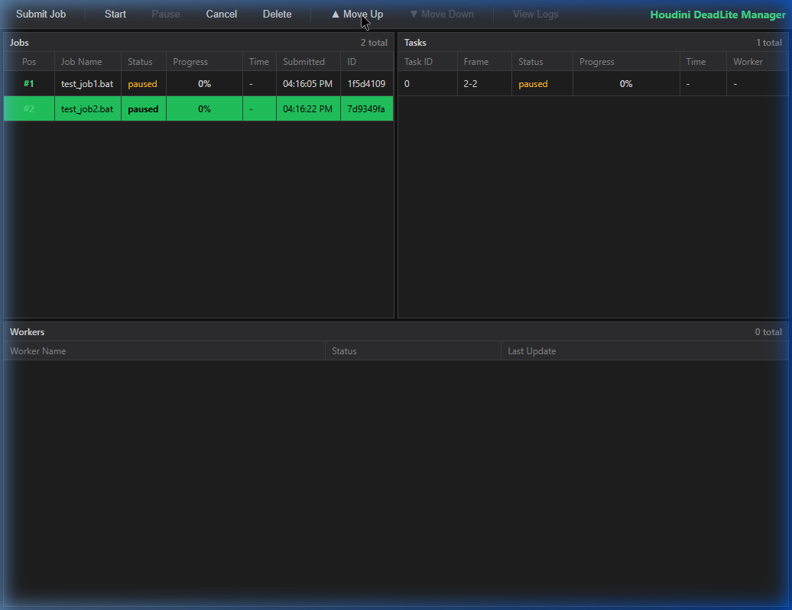

# Houdini DeadLite Manager

**Houdini DeadLite Manager** is a highly lightweight, zero-installation, portable local render manager designed specifically for **SideFX Houdini** and **Solaris** workflows. 

*(Note: This tool is currently Windows-only.)*

It was built to solve a specific pain point: setting up official render managers like AWS Thinkbox Deadline or SideFX HQueue for a small home network or indie studio is often overkill. They require heavy database installations (like MongoDB), complex network configurations, and dedicated server software. 

Houdini DeadLite Manager provides a fast, drag-and-drop solution for small 2-to-3 machine network rendering without any of the headache.



## Download
You can download the latest pre-compiled, portable executables for Windows from the **[GitHub Releases](https://github.com/cmolfino-lab/cmolfino-lab-Houdini-DeadLite-Manager/releases)** page.


## Features
* **Zero-Installation:** Runs entirely from portable `.exe` files. No databases, no background services, no complex setup.
* **Submit from Houdini:** A **Submit to DeadLite** shelf tool sends the selected render node straight to the manager. No `.bat` files, no manual USD export.
* **Two render routes:** USD Render ROPs are baked to USD once and rendered with `husk`, which starts immediately and needs no scene load. Any other ROP (Redshift, geometry caches, simulations) is rendered by `hython` from a snapshot of the scene.
* **Frames per task:** Each job is cut into tasks of a few frames. A task is one render process on one machine, so the machines share the job and GPU memory is released between tasks.
* **Reliable cancel:** Cancelling or deleting stops the whole render process tree. Closing a worker stops its render and puts the task back in the queue.
* **Resume:** A task that is cancelled or fails part-way restarts at the frames that are not on disk yet. A task that fails on one machine is tried on the other first.
* **Version matching:** Each worker finds its own Houdini installs. A job only goes to a worker that has the Houdini version it was submitted from.
* **Survives restarts:** The queue and the task logs are kept on disk next to the manager. Close the manager and start it again: the jobs are still there, and renders that were running carry on.
* **Worker switch:** Disable a machine from the dashboard to keep it free. It finishes its current task and takes no more until it is enabled again.
* **Visual Queue Prioritization:** Instantly adjust rendering priority by moving jobs up or down physically using **▲ Move Up** and **▼ Move Down** buttons on the dashboard.
* **Queue-Aware Dispatching:** Connected worker nodes automatically respect your queue order, concentrating resources on the highest-priority job at the top of the queue first before cascading to the next.
* **Multi-Engine Support:** Works out-of-the-box with **Karma CPU**, **Karma XPU**, and **Redshift**.
* **Real-time Progress Tracking:** Intercepts `ALF_PROGRESS` statements natively from Houdini's command-line tools to provide live, dynamic progress bars in the UI.
* **Responsive Dashboard:** A clean, modern Web UI to track your Jobs, Tasks, and Worker statuses.

*(Note: Houdini DeadLite Manager is explicitly hard-coded for Houdini. Out of the box, it will not work with other DCCs like Maya or Blender without modification.)*

## Architecture
Houdini DeadLite Manager uses a simple Manager/Worker architecture over standard HTTP requests:
* **`deadlite_manager.exe`**: Acts as the central server and hosts the dashboard UI on port `5000`. You run this on your main workstation.
* **`deadlite_worker.exe`**: Acts as the client. You run this on any rendering nodes on your network (one per machine). It polls the manager for tasks and reports progress back every two seconds.
* **`houdini/`**: The shelf tool that submits jobs from inside Houdini.

The manager keeps its queue in a `deadlite_data` folder next to the exe: `queue.json` plus one log file per task. Renders carry on while the manager is closed, and when it starts again each worker has 30 seconds to report in before its task is handed to someone else. Delete the folder (with the manager closed) to start with an empty queue.

The manager listens on port `5000` on every network address. Set the environment variables `DEADLITE_PORT` or `DEADLITE_HOST` before starting it to change that.

## Usage

1. **Download** the latest `deadlite_manager.exe` and `deadlite_worker.exe` from the [Releases](https://github.com/cmolfino-lab/cmolfino-lab-Houdini-DeadLite-Manager/releases) page. The manager and every worker must be the same version; a worker on a different one is shown as **Outdated** and gets no work.
2. **Launch `deadlite_manager.exe`** on your main workstation.
3. **Launch `deadlite_worker.exe`** on any machines you want to use for rendering, including the workstation itself. On first start it writes a `config.json` next to the exe; set `MANAGER_URL` to the manager's host name or IP address, e.g. `http://my-workstation:5000`, and restart the worker.
4. **Open the Dashboard**: Navigate to `http://localhost:5000` in your web browser.
5. **Submit a Job** from Houdini (see below).

Uploaded `.bat` jobs wait for **Start**. Select a single task and press **Start Task** to test-render one chunk before releasing the whole job.

### Worker `config.json`

| Key | Meaning |
|---|---|
| `MANAGER_URL` | Where the manager is, e.g. `http://my-workstation:5000`. |
| `HOUDINI_DIRS` | Optional list of extra folders that contain `Houdini <version>` installs. `C:\Program Files\Side Effects Software` is always searched. |

## Submitting from Houdini

### Install

Copy the two files in `houdini/` into any folder on your `HOUDINI_PATH` (a package folder, or your Houdini preferences folder), keeping their sub-folders:

```
houdini/scripts/python/deadlite_submit.py   ->  <folder>/scripts/python/deadlite_submit.py
houdini/toolbar/deadlite.shelf              ->  <folder>/toolbar/deadlite.shelf
```

Restart Houdini, then add the shelf: the **+** at the right of the shelf set > **Shelves** > **DeadLite**. Works in Houdini 21 and 22.

### Use

1. Select the node to render: a USD Render ROP (in `/out`, a ROP network, or a LOP network), or any other ROP.
2. Click **Submit to DeadLite**. The dialog is prefilled from the node:
   * **Frames**: start, end and step.
   * **Frames per task**: how many frames each render process does. Aim for roughly 10-20 minutes per task: more frames for light scenes, fewer for heavy ones. `0` keeps everything in one task.
   * **USD renders**: *Bake USD, render with husk* (default) or *Open the scene with hython*.
   * **Keep caches and simulations in one task**: on by default, because a simulation cannot be split across machines.
   * **Manager**: the manager's address. Remembered between sessions.
3. Press **Submit**. The job appears on the dashboard.

Each job gets a folder in `$HIP/deadlite/` holding what the workers load: the baked USD, or a snapshot of the `.hip`. Later edits to your scene do not change a job that is already queued. These folders are not cleaned up automatically.

Everything set on the USD Render ROP is used, on both routes: render delegate, Render Settings, Render Pass, Override Camera, Override Resolution, Override Output Image, the Husk tab and so on. For the husk route the tool does not interpret these itself: it lets the node put its husk command line together and records it, so options added in future Houdini versions are carried over too.

An **Override Output Image** can use `$F4` as usual, e.g. `$HIP/render/$OS/$OS.$F4.exr`. The backslash that the warning under the parameter asks for is not needed: the frame number is handed to husk as its own `<F4>` token. An override driven by an expression that changes per frame cannot be passed on this way; the husk route refuses it with a message, and the hython route falls back to one husk process per frame.

Paths must be reachable from every worker under the same drive letters. A worker that cannot reach the scene file says so in the task's log.

## Building and testing

`build_exes.bat` builds both executables into `dist/` with PyInstaller. It expects a virtual environment in `venv` with the packages from `requirements.txt` (`venv\Scripts\python -m pip install -r requirements.txt`). Close the running manager and worker first, or the old exes cannot be replaced.

```
venv\Scripts\python -m unittest discover tests -b
```

## Fallback: .bat files

A `.bat` file can still be uploaded with **Submit Job** on the dashboard, or by dropping it anywhere on the page. Each `hython`, `hrender` or `husk` line becomes one task, run in the folder of the preceding `cd /d` line. Such a job is tied to the Houdini path written in the file, so every worker needs that exact build in the same place, and it cannot resume part-way. The two scripts below generate compatible files.

### 1. Solaris / USD (.bat Generator)
Use this tool when rendering a baked `.usd` file via `husk`. It allows you to explicitly force the GPU/CPU render delegate.

```python
import hou
import os
import math

def generate_husk_batch_script():
    hip_dir = hou.getenv('HIP')
    usd_file = hou.ui.selectFile(start_directory=hip_dir, title="Select Baked .usd", pattern="*.usd *.usda *.usdc", chooser_mode=hou.fileChooserMode.Read)
    if not usd_file: return
    usd_file = hou.expandString(usd_file)

    start_frame, end_frame = int(hou.playbar.playbackRange()[0]), int(hou.playbar.playbackRange()[1])
    frame_result = hou.ui.readMultiInput("Enter the Frame Range:", ("Start Frame", "End Frame"), title="Frame Range", buttons=("Next", "Cancel"), initial_contents=(str(start_frame), str(end_frame)))
    if frame_result[0] == 1: return
    
    f_start, f_end = int(frame_result[1][0]), int(frame_result[1][1])

    delegates = ["Karma CPU", "Karma XPU", "Redshift", "Default (Auto-detect)"]
    del_flags = ["-R Karma --engine cpu", "-R Karma --engine xpu", "-R Redshift", ""]
    
    del_choice = hou.ui.selectFromList(delegates, exclusive=True, title="Select Render Delegate")
    if not del_choice: return
        
    render_flag = del_flags[del_choice[0]]
    if render_flag: render_flag += " "

    batch_choice = hou.ui.displayMessage("How would you like to render?", buttons=("All in one batch", "Chunking", "Cancel"))
    if batch_choice == 2: return
        
    frames_per_batch = 0
    if batch_choice == 1:
        input_result = hou.ui.readInput("Frames per batch:", buttons=("OK", "Cancel"), initial_contents="10")
        if input_result[0] == 1: return
        frames_per_batch = int(input_result[1])

    bat_file = hou.ui.selectFile(start_directory=os.path.dirname(usd_file), title="Save Batch File", pattern="*.bat", chooser_mode=hou.fileChooserMode.Write)
    if not bat_file: return
    bat_file = hou.expandString(bat_file)
    if not bat_file.endswith('.bat'): bat_file += '.bat'

    h_bin = hou.getenv('HB').replace('\\', '/')
    usd_path = usd_file.replace('\\', '/')
    commands = [f'cd /d "{h_bin}"\n\n']
    total_frames = (f_end - f_start) + 1

    if batch_choice == 0 or frames_per_batch == 0:
        commands.append(f'husk {render_flag}-Va --make-output-path -f {f_start} -n {total_frames} "{usd_path}"\n')
    else:
        current_start = f_start
        while current_start <= f_end:
            frames_left = (f_end - current_start) + 1
            chunk_size = min(frames_per_batch, frames_left)
            commands.append(f'husk {render_flag}-Va --make-output-path -f {current_start} -n {chunk_size} "{usd_path}"\n')
            current_start += chunk_size

    commands.append('\n\npause\n')
    with open(bat_file, 'w') as f: f.writelines(commands)
    hou.ui.displayMessage(f"Saved to:\n{bat_file}", title="Success")

generate_husk_batch_script()
```

### 2. Standard / ROP (.bat Generator)
Use this tool for traditional Houdini rendering (e.g. Redshift out of the `/out` context) via `hython` and `hrender.py`.

> [!WARNING]
> **Important Note for Solaris users using `hython`**: If you are using this `hython` script to render a **USD Render ROP**, you **MUST** ensure the `Render All Frames with a Single Process` checkbox is TICKED on your USD Render ROP. Otherwise, Houdini will spin up a separate `husk` process for every single frame, which is extremely slow. For Solaris, it is highly recommended to use the `husk` script above instead!

```python
import hou
import os

def generate_hython_batch_script():
    hip_file = hou.hipFile.path()
    if hip_file == "untitled.hip" or not os.path.exists(hip_file):
        hou.ui.displayMessage("Please save your scene first.", severity=hou.severityType.Error)
        return
    hip_file = hip_file.replace('\\', '/')

    rop_path = hou.ui.selectNode(title="Select ROP Node", node_type_filter=hou.nodeTypeFilter.Rop)
    if not rop_path: return
    rop_node = hou.node(rop_path)
    
    try:
        start_frame, end_frame = int(rop_node.evalParm('f1')), int(rop_node.evalParm('f2'))
    except:
        start_frame, end_frame = int(hou.playbar.playbackRange()[0]), int(hou.playbar.playbackRange()[1])
        
    frame_result = hou.ui.readMultiInput("Enter the Frame Range:", ("Start Frame", "End Frame"), buttons=("Next", "Cancel"), initial_contents=(str(start_frame), str(end_frame)))
    if frame_result[0] == 1: return
    f_start, f_end = int(frame_result[1][0]), int(frame_result[1][1])

    batch_choice = hou.ui.displayMessage("How would you like to render?", buttons=("All in one batch", "Chunking", "Cancel"))
    if batch_choice == 2: return
        
    frames_per_batch = 0
    if batch_choice == 1:
        input_result = hou.ui.readInput("Frames per batch:", buttons=("OK", "Cancel"), initial_contents="10")
        if input_result[0] == 1: return
        frames_per_batch = int(input_result[1])

    bat_file = hou.ui.selectFile(start_directory=os.path.dirname(hip_file), title="Save Batch File", pattern="*.bat", chooser_mode=hou.fileChooserMode.Write)
    if not bat_file: return
    bat_file = hou.expandString(bat_file)
    if not bat_file.endswith('.bat'): bat_file += '.bat'

    h_bin = hou.getenv('HB').replace('\\', '/')
    commands = [f'cd /d "{h_bin}"\n\n']

    if batch_choice == 0 or frames_per_batch == 0:
        commands.append(f'hython hrender.py -e -f {f_start} {f_end} -d {rop_path} "{hip_file}"\n')
    else:
        current_start = f_start
        while current_start <= f_end:
            frames_left = (f_end - current_start) + 1
            chunk_size = min(frames_per_batch, frames_left)
            current_end = current_start + chunk_size - 1
            commands.append(f'hython hrender.py -e -f {current_start} {current_end} -d {rop_path} "{hip_file}"\n')
            current_start += chunk_size

    commands.append('\n\npause\n')
    with open(bat_file, 'w') as f: f.writelines(commands)
    hou.ui.displayMessage(f"Saved to:\n{bat_file}", title="Success")

generate_hython_batch_script()
```
